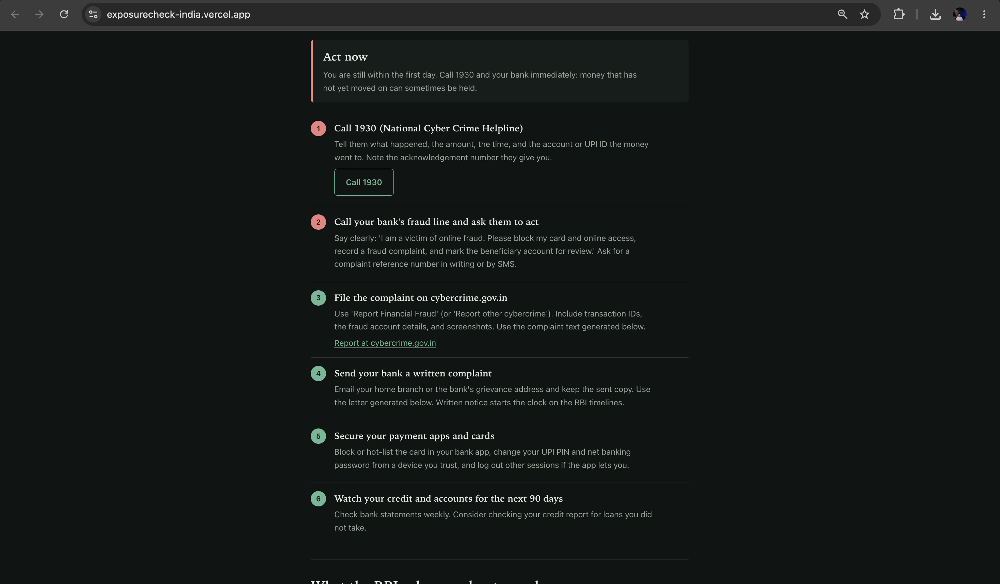
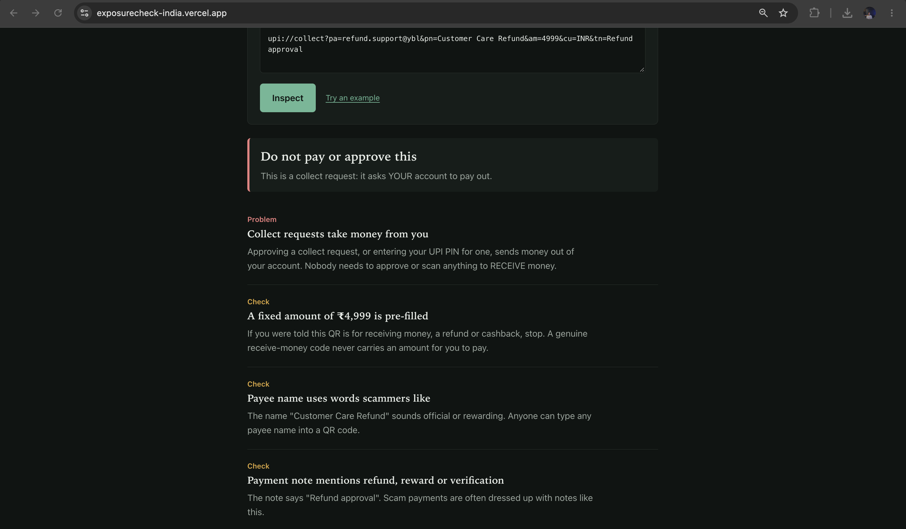

# ExposureCheck India

A free, no-signup toolkit for people in India dealing with online fraud and data exposure. It is an open-source learning project built on public data sources.

**Live:** https://exposurecheck-india.vercel.app
(Hosted on free tiers: the first load after a quiet period can take about a minute, and the email breach lookup has a daily limit.)

| "I've been scammed" planner | UPI QR / link inspector |
|---|---|
|  |  |

## Tools

- **I've been scammed:** answer a few questions (what happened, how long ago, how the money moved) and get an ordered checklist built around the 1930 helpline and cybercrime.gov.in, a plain-language summary of the RBI customer-liability rules, an evidence checklist, and ready-to-copy complaint and bank-letter text. Runs in the browser; nothing is stored.
- **UPI QR / link check:** upload a QR screenshot (decoded in the browser with jsQR) or paste a `upi://` link or UPI ID. It explains whether the code pays, collects money from you, or sets up an auto-debit, and flags pre-filled amounts, missing payee names, official-sounding UPI IDs and bait wording. Camera scanning is not built in.
- **Scam message check:** rule-based detection of common Indian scam patterns in English, Hinglish and Hindi (Devanagari): KYC threats, fake courier and utility notices, OTP requests, "digital arrest" calls, prize and job scams, look-alike bank links. Genuine "do not share your OTP" warnings are not flagged.
- **Email header analysis:** paste raw headers to read SPF, DKIM and DMARC results, compare sender fields, and trace the message path.
- **Password check:** checks a password against the Pwned Passwords range API using k-anonymity (only the first 5 characters of the SHA-1 hash leave your browser).
- **Email breaches:** looks up an email in a breach database, adds India-specific guidance, a transparent 0-100 risk score, remediation steps and a MITRE ATT&CK mapping. Optionally checks a domain you own via certificate-transparency logs (crt.sh) and DNS (SPF, DMARC, DKIM on common selectors).

## What it does not do

- The checkers find warning signs. They cannot prove a message, QR code or link is safe or malicious.
- The UPI inspector reads what is written in the code; it cannot tell who actually owns the account.
- The RBI liability text is a plain-language summary, not legal advice.
- No accounts, no phone-number lookup, no social-media scraping, no dark-web monitoring.

## Privacy

Message, QR, header, password and incident-planner analysis runs in your browser and is not sent anywhere. The email scan sends the address to a third-party breach database; the backend stores only anonymous daily aggregate counters. Details in [PRIVACY.md](PRIVACY.md).

## Breach data source

Selected with `BREACH_PROVIDER`:
- `xposedornot` (default when no key is set): free [XposedOrNot](https://xposedornot.com) breach analytics. The free tier is rate-limited per server IP (roughly 100 lookups a day), so heavy use will hit the cap.
- `hibp`: [HaveIBeenPwned](https://haveibeenpwned.com/API/v3) with `HIBP_API_KEY`. Their breached-account lookup needs a paid key; check their terms before using it for a public service.
- `HIBP_DEMO=1` returns clearly labelled fictional sample data for UI development.

The India-related breach list in `backend/app/data/india_breaches.json` is curated and best-effort. DKIM detection is selector-guessing by design, so a miss is reported as inconclusive.

## Architecture

```
React + Vite SPA
  |- browser-only tools: incident planner, UPI inspector, scam checker,
  |  header analyzer, password check (src/lib/*.js, unit-tested)
  '- POST /api/scan --> FastAPI
                         |- hibp.py / xposedornot.py   breach lookup
                         |- crtsh.py                   certificate transparency
                         |- dns_checks.py              SPF / DKIM / DMARC
                         |- scoring.py                 rule-based 0-100 score
                         |- remediation.py, indian_context.py, mitre.py
                         '- db.py                      daily aggregate counters
```

## Run locally

```bash
# Backend (Python 3.10+; 3.12 recommended)
cd backend
python3.12 -m venv .venv && source .venv/bin/activate
pip install -r requirements-dev.txt
cp .env.example .env             # BREACH_PROVIDER=xposedornot works without a key
set -a && source .env && set +a
uvicorn app.main:app --reload --reload-dir app    # http://localhost:8000/api/docs
python -m pytest -q

# Frontend (separate terminal)
cd frontend
npm install
npm run dev                      # http://localhost:5173 (proxies /api to :8000)
npm test                         # node --test
```

## Deploy

- **Backend** (Render, Docker): root directory `backend`; env `BREACH_PROVIDER`, `HIBP_DEMO=0`, `TRUST_PROXY=1`, `CORS_ORIGINS` (the exact frontend origin, e.g. `https://exposurecheck-india.vercel.app`, with scheme and no trailing slash).
- **Frontend** (Vercel/Netlify): root directory `frontend`, build `npm run build`, output `dist`, env `VITE_API_URL=<backend URL>` (no trailing slash). Vite bakes this in at build time, so redeploy after changing it.

## Tests

Backend: pytest. Frontend: `node --test` over the pure-logic libraries in `frontend/src/lib`. Network-dependent pieces (live DNS, crt.sh, the breach provider) are covered with mocks.

## License

See [LICENSE](LICENSE).
